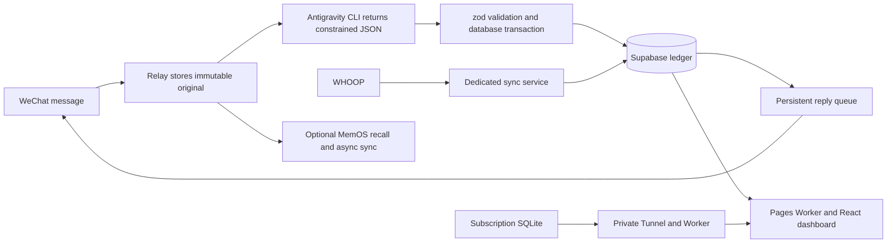

<!--
[INPUT]: 发布源码、宣传片、部署脚本与隐私访问契约。
[OUTPUT]: 英文介绍、宣传片、实现方法及完整部署流程。
[POS]: GitHub英文入口；中文版位于README.md。
[PROTOCOL]: 变更时更新此头部，然后检查 CLAUDE.md
-->
<p align="center">
  
</p>
<h1 align="center">LifeOS · Personal Steward</h1>
<p align="center">Capture life in WeChat. Connect your time, finances and wellbeing.</p>
<p align="center"><a href="README.md">简体中文</a> · <strong>English</strong></p>
<p align="center">
  <a href="https://lifeos.zhaozimin.com">Live demo</a> ·
  <a href="https://zhaozimin.com">Zhao Zimin</a> ·
  <a href="https://ui.zhaozimin.com">Zhi Mo Zhu design system</a>
</p>

[Launch film](#launch-film) · [How it works](#how-it-works) · [Requirements](#0-prepare-resources-and-choose-a-scope) · [Full deployment](#full-deployment) · [Local preview](#local-preview)

LifeOS is a personal life logging system. Tell your WeChat steward what you are doing, what you spent or what you want to remember. Review the results on a unified dashboard for time, money, subscriptions and health.

The interface uses the Zhi Mo Zhu design system. Its Ardisia crenata logo combines ink colored leaves with vermilion berries. All three interfaces share the same brand source.

## Launch film

<p align="center">
  <a href="docs/media/lifeos-launch.mp4"></a>
</p>

**A day, connected** · 60 seconds · 1440×1080 · Music, no voice-over.
Click the preview to open the [complete video file](docs/media/lifeos-launch.mp4), or [download the MP4](https://github.com/zhaozimin/lifeos.zhaozimin.com/raw/refs/heads/main/docs/media/lifeos-launch.mp4). All on-screen records are synthetic demo data. The video, preview and poster ship with the repository; see [media assets](docs/media/README.md).

Created with [huashu-motion](https://github.com/alchaincyf/huashu-motion).

## Features

| Module | Capabilities |
|---|---|
| WeChat steward | Activity and expense capture, conversation, follow-up context and time-range corrections |
| Time | Daily and weekly timelines, activity switching, category statistics and editing |
| Finance | Transactions, financial overview, cash flow and chart drill-down |
| Subscriptions | Brand cards, renewal statistics, browser notifications and optional seven-day WeChat reminders |
| Health | WHOOP metrics, trends, workouts and daily exercise guidance |
| Memory | Optional MemOS cloud long-term memory |
| Privacy | Read-only guest access; password and TOTP for private owner data |

WeChat parsing uses Antigravity CLI. This path does not require a separate model API key. WHOOP, MemOS and other integrations still require their own authorization or credentials.

## How it works



- **Store before parsing:** original messages are saved first. The CLI produces constrained JSON; zod validates it before restricted database transactions write records. The model does not execute SQL.
- **Replies follow committed facts:** accounting receipts come from the ledger and use a persistent retry queue. Conversation has its own answer field and bounded context.
- **Keep domain sources explicit:** Supabase owns time and finance; VPS SQLite owns subscriptions; a dedicated service synchronizes WHOOP and publishes health snapshots.
- **Enforce public scope on the server:** Pages checks sessions, private-table RLS requires owner AAL2, and guests use read-only projections containing allowed fields.
- **Separate credentials:** server database keys and device tokens stay in their backends. The website uses a publishable key and the owner's session.

Code entry points: [WeChat receiver](apps/relay/src/channel/wechat.ts) · [parser rules](apps/relay/prompts/parse.md) · [restricted writes](apps/relay/src/store/supabase.ts) · [web Worker](apps/web/worker/index.ts) · [database migrations](supabase/migrations).

## Local preview

Install Node.js **22.13+** and Python **3**, then run:

```sh
git clone https://github.com/zhaozimin/lifeos.zhaozimin.com.git
cd lifeos.zhaozimin.com
npm run ui
```

Open <http://127.0.0.1:5173/dashboard/time/day>.

The launcher installs missing locked dependencies and builds the subscription interface. The preview needs no login and uses **synthetic data only**. Time and finance changes stay in memory; subscriptions use a temporary database. Restarting resets them. The preview does not connect to production or publish your changes.

See the [UI handoff guide](docs/UI美化交接.md) for editing locations and preview behavior.

## Guests and owner access

Guests can browse public time records, health metrics and subscription cards. Finance keeps its layout and browsing interactions, with monetary values, accounts and private descriptions replaced by `••••`. Financial charts are explicitly illustrative. Bank cards, original messages, attachments and private notes remain protected.

Real monetary values are removed from the public server projection. Guests cannot write, synchronize or export private data. Owner access requires a password, six-digit TOTP, server checks and database row-level security. Hiding the login link changes navigation; it is not an authorization boundary.

Read the [guest access contract](docs/访客访问.md) and [security review summary](docs/安全审计.md) for scope and limitations.

## Repository map

```text
apps/relay/          WeChat steward, Antigravity parsing and memory queue
apps/web/            React dashboard and Cloudflare Pages Worker
apps/whoop/          WHOOP sync, health analysis and exercise plans
apps/subscriptions/  SubOS interface and private subscription service
supabase/            Database migrations and authorization tests
ops/                 Preview, deployment and encrypted backup tools
design/zzm/          Pinned Zhi Mo Zhu design system
docs/                Architecture, operating contracts and sanitized reports
```

Stack: React 19 · TypeScript · Tailwind CSS · Vite · ECharts · Supabase · Cloudflare Pages / Workers · Python · SQLite.

## Full deployment

**This is a manual, single-owner deployment. There is no one-click installer. Antigravity sign-in and the WeChat QR code are only two steps.** Use your own server, cloud resources and authorizations. These instructions target a **new installation**; back up existing instances before upgrades and do not overwrite their databases or state directories.

### 0. Prepare resources and choose a scope

| Resource | Purpose | Requirement |
|---|---|---|
| Ubuntu 24.04 x86_64 VPS | Persistent WeChat receiver, CLI and backends | Platform used by the scripts below |
| Supabase project | Records, authorization and website account | Create an independent empty project |
| Cloudflare account | Pages, internal Worker and private connectivity | Required for the full website |
| Google / Antigravity authorization | AI parsing and replies | Eligible account, available model and quota |
| WeChat | Bind your own session | Complete confirmation on the phone |
| WHOOP | Health sync | Optional; your own OAuth application and authorization |
| MemOS | Cloud long-term memory | Optional; your own API key |
| Private R2 bucket and age keys | Encrypted backups | Recommended for production |

On your workstation, install Node.js 22.13+, Python 3, Git, SSH and the [Supabase CLI](https://supabase.com/docs/guides/local-development/cli/getting-started). Wrangler is installed with the locked dependencies in `apps/web`. Commands below distinguish your workstation, VPS root terminal and VPS `lifeos` session. Run `ssh root@YOUR_VPS_HOST` on your workstation to enter the VPS. Run `runuser -l lifeos` in its root terminal to enter a lifeos session; use `exit` to return to root. In each new lifeos session, run `export PATH="/home/lifeos/.local/bin:$PATH"`.

**Antigravity usage boundary:** the adapter calls the official CLI. Google's FAQ says consumer plans do not support wrapping `agy` in third-party applications. This project does not promise official support for that use merely because personal sign-in succeeds. Confirm eligibility, scope and quota before enabling AI. Set `PARSER_ENABLED=false` to verify original-message storage first without AI parsing. [Official FAQ](https://antigravity.google/docs/faq)

### Tools and deployment order

| Location | Tools | Purpose |
|---|---|---|
| Workstation | Git, Node.js 22.13+, npm, Python 3, SSH/SCP | Clone, build, run synthetic previews and connect to the VPS |
| Workstation | Supabase CLI, Wrangler (locked web dependency) | Apply migrations and deploy Workers and Pages |
| VPS | Ubuntu 24.04 x86_64, systemd, curl, xz, util-linux | Dedicated services, installation and session locking |
| VPS | Dedicated Node.js 22, Antigravity CLI, Python 3 | WeChat parsing, health and subscription backends |
| VPS | cloudflared | Private subscription connectivity |
| Optional backup | PostgreSQL client, age, AWS CLI | Consistent export, encryption, upload and isolated recovery |

Recommended order: **local preview → VPS runtime → Supabase and owner account → CLI authorization → WeChat binding → relay → subscriptions and private connectivity → Pages → two-factor acceptance → optional integrations**.
A local preview only needs the first row. The full hosted system also needs the accounts and authorizations listed above.

### 1. Install the source and runtimes on the VPS

In the **VPS root terminal**, using a new installation directory:

```sh
set -e
umask 022
apt-get update
apt-get install -y ca-certificates curl git python3 xz-utils util-linux
git clone https://github.com/zhaozimin/lifeos.zhaozimin.com.git /opt/lifeos
cd /opt/lifeos
bash ops/install-antigravity.sh
bash ops/install-node.sh
chown -R lifeos:lifeos /opt/lifeos
```

The scripts create a dedicated `lifeos` user and install CLI and Node in its home, without replacing system Node. Installer and archive digests are pinned. Review upstream changes if verification fails; do not remove the checks. Other CPU architectures need adapted installation steps.

### 2. Create the Supabase database and owner account

Create an empty project in your Supabase dashboard. Keep its URL, project ref, publishable key, server credential and database password privately. The server setting is named `SUPABASE_SERVICE_ROLE_KEY`; supply the corresponding server credential for your own project. The website uses an `sb_publishable_...` key and must not receive the server credential.

In the **workstation terminal**, from the cloned repository root:

```sh
supabase login
supabase link --project-ref YOUR_PROJECT_REF
supabase db push --include-all --dry-run
supabase db push --include-all
```

Check that the dry run targets your empty project. There are currently 27 migrations, `0001` through `0027`. Do not run `db reset` against an existing production database. Alternatively, apply every SQL file in order in SQL Editor and maintain matching migration history to prevent duplicate application. [CLI reference](https://supabase.com/docs/reference/cli/supabase-db-push)

Under **Authentication → Users**, manually create your owner email/password account, confirm its email state and save its UUID. Disable public signup and enable TOTP. The local `supabase/config.toml` does not automatically change hosted Auth settings. Use a password of at least 20 characters from initialization.

Run the SQL below in **SQL Editor**, replacing `REPLACE_WITH_OWNER_UUID`. It installs template categories, fallback categories and a disabled guest configuration, without importing author records. WHOOP timeline alignment starts disabled until your device is connected. Existing time categories are not reset.

```sql
do $$
declare
  v_owner uuid := 'REPLACE_WITH_OWNER_UUID'::uuid;
begin
  if not exists(select 1 from auth.users where id=v_owner) then
    raise exception 'Create the Auth user first';
  end if;
  if exists(select 1 from public.visitor_settings where id=1 and owner_id<>v_owner) then
    raise exception 'This database belongs to another owner';
  end if;
  if not exists(select 1 from public.categories where owner_id=v_owner and kind='time') then
    perform public.install_time_groups(v_owner, repeat('0',64),
      '[{"code":"time-group-work","name":"工作","nature":"core"},
        {"code":"time-group-learning","name":"学习成长","nature":"core"},
        {"code":"time-group-personal","name":"生活自理","nature":"support"},
        {"code":"time-group-food","name":"饮食","nature":"recovery"},
        {"code":"time-group-rest","name":"清醒休息","nature":"recovery"},
        {"code":"time-group-sleep","name":"睡眠","nature":"recovery"},
        {"code":"time-group-exercise","name":"运动","nature":"recovery"},
        {"code":"time-group-leisure","name":"娱乐","nature":"leisure"},
        {"code":"time-group-social","name":"私人社交","nature":"leisure"},
        {"code":"time-group-travel","name":"出行","nature":"support"},
        {"code":"uncategorized","name":"待确认","nature":"support"}]'::jsonb,
      '[]'::jsonb, true);
    update public.time_group_policies set sleep_authority=false where owner_id=v_owner;
  end if;
  insert into public.categories(owner_id,kind,code,name,nature)
    values(v_owner,'time','uncategorized','待确认','support')
    on conflict(owner_id,kind,code) do nothing;
  insert into public.categories(owner_id,kind,code,name,direction) values
    (v_owner,'money','uncategorized','待确认',null),
    (v_owner,'money','food','餐饮','expense'),
    (v_owner,'money','transport','交通','expense'),
    (v_owner,'money','software','软件与工具','expense'),
    (v_owner,'money','living','生活消费','expense'),
    (v_owner,'money','income','收入','income')
    on conflict(owner_id,kind,code) do nothing;
  insert into public.visitor_settings(id,owner_id,enabled,share_activity_titles)
    values(1,v_owner,false,false) on conflict(id) do nothing;
end;
$$;
```

### 3. Authorize Antigravity and verify model access

In the **workstation terminal**, replace `YOUR_VPS_HOST`:

```sh
ssh -t root@YOUR_VPS_HOST 'runuser -l lifeos -w SSH_CONNECTION,SSH_CLIENT,SSH_TTY,TERM -c "cd /var/lib/lifeos/parser-workspace && exec /home/lifeos/.local/bin/agy"'
```

Follow the CLI's browser authorization, required account checks and initial setup. Credentials stay under the dedicated VPS user. Do not copy another user's login files. Inspect models available to your account; `AGY_MODEL` below must match a verified model ID. The example default is not a promise of availability for every account.

In the **VPS lifeos session**, test a headless invocation:

```sh
cd /var/lib/lifeos/parser-workspace
/home/lifeos/.local/bin/agy -p "Reply only ok. Do not use tools." --output-format json --print-timeout 60s
```

Check successful exit and output before enabling parsing. Resolve CLI eligibility, authorization or quota errors first; do not bypass permissions or rotate accounts. See [Antigravity operations](ops/antigravity.md).

### 4. Generate the QR code and bind WeChat

In the **VPS lifeos session**, use the installed Node:

```sh
export PATH="/home/lifeos/.local/bin:$PATH"
cd /opt/lifeos/ops
npm ci --ignore-scripts
npm run prepare:wechat
mkdir -p /var/lib/lifeos/wechat
chmod 700 /var/lib/lifeos/wechat
flock -n /var/lib/lifeos/wechat/login.lock node wechat-login.mjs
```

Keep this terminal running. In a second **workstation terminal**, retrieve the image:

```sh
scp root@YOUR_VPS_HOST:/var/lib/lifeos/wechat/login-qr.png ./lifeos-login-qr.png
```

Open the PNG locally, scan it in WeChat and confirm on the phone. Follow the terminal prompts if a pairing code is requested. Check `/var/lib/lifeos/wechat/login-status.json` on the VPS: only `bound` means success. Retrieve the latest PNG if it changes, and delete the local QR image after binding.

**The QR tool saves a session; it does not receive or answer messages.** Run only one receiver for the same bot. Stop the existing relay before re-binding. See [WeChat binding](ops/wechat.md).

### 5. Configure and start the steward

In the **VPS root terminal**:

```sh
cd /opt/lifeos
install -d -m 0700 /etc/lifeos
install -m 0600 apps/relay/.env.example /etc/lifeos/relay.env
```

Edit `/etc/lifeos/relay.env` privately:

| Setting | Value |
|---|---|
| `SUPABASE_URL` | Your project URL |
| `SUPABASE_SERVICE_ROLE_KEY` | Your server-only project credential |
| `OWNER_AUTH_ID` | Owner UUID from step 2 |
| `AGY_BIN`, `AGY_WORKSPACE` | Dedicated-user paths from the template |
| `AGY_MODEL` | A model ID verified in step 3 |
| `PARSER_ENABLED` | `true` after authorization and usage scope checks; `false` for original-message storage |
| `MEMOS_ENABLED` | Keep `false` until memory is configured |

Then run:

```sh
bash /opt/lifeos/ops/deploy-relay.sh
systemctl is-active lifeos-relay.service
journalctl -u lifeos-relay.service -n 30 --no-pager
```

The script builds the relay and copies steward rules into workspace `AGENTS.md`. Doctor checks the owner, categories, migrations and CLI before startup. Failed checks block the receiver. To change rules, edit `apps/relay/prompts/parse.md` and run the deployment script again; do not change only the workspace copy.

### 6. Install the subscription backend

**The full website requires steps 6–8. Authentication throttling currently shares the subscription Worker's service binding. Even if you do not use subscriptions yet, do not omit the entire internal Worker.** Its deployment template also requires your own VPC Service ID.

First build standalone subscription assets in the **VPS lifeos session**:

```sh
export PATH="/home/lifeos/.local/bin:$PATH"
cd /opt/lifeos/apps/subscriptions/web
npm ci
npm run build:standalone
```

In the **VPS root terminal**, prepare a dedicated runtime. These commands are for a first install. If the user, directories or `runtime` already exist, inspect them and do not delete existing data:

```sh
useradd --system --user-group --home-dir /var/lib/lifeos-subscriptions --no-create-home --shell /usr/sbin/nologin lifeos-subscriptions
install -d -m 0755 /opt/lifeos-subscriptions/server
cp -a /opt/lifeos/apps/subscriptions/server/. /opt/lifeos-subscriptions/server/
install -d -m 0700 -o lifeos-subscriptions -g lifeos-subscriptions /var/lib/lifeos-subscriptions
test ! -e /opt/lifeos-subscriptions/server/runtime
ln -s /var/lib/lifeos-subscriptions /opt/lifeos-subscriptions/server/runtime
install -m 0644 /opt/lifeos/ops/lifeos-subscriptions.service /etc/systemd/system/lifeos-subscriptions.service
systemctl daemon-reload
systemctl enable --now lifeos-subscriptions.service
curl --fail http://127.0.0.1:18787/v1/health
```

The server creates an empty SQLite schema. It does not import author subscriptions, accounts or bank cards. The `runtime` symlink directs writable icons and card art to the state directory. Keep the backend on loopback. See the [subscription contract](docs/订阅接入.md).

### 7. Create private Cloudflare connectivity and the internal Worker

Follow the [Workers VPC guide](https://developers.cloudflare.com/workers-vpc/get-started/) in your own account. Create a Tunnel, install and run official `cloudflared` on the VPS, and confirm connectivity. VPC needs outbound QUIC; use the current [Tunnel version and networking requirements](https://developers.cloudflare.com/workers-vpc/configuration/tunnel/).

Create an **HTTP VPC Service** through that Tunnel, targeting `127.0.0.1` on HTTP port `18787`. Save your Service ID. **Do not create a public hostname route or open inbound VPS port 18787.** A temporary public Tunnel URL is not a substitute for this private connection.

In the **workstation terminal**, start in the root of your local clone, then install the web tools and sign in to Cloudflare:

```sh
cd apps/web
npm ci
npx wrangler login
cd ../subscriptions/edge
cp wrangler.example.toml wrangler.toml
```

Edit local `wrangler.toml`: replace `REPLACE_WITH_VPC_SERVICE_ID` with your ID. Choose a positive `namespace_id` not shared with other policies in your account. Keep `workers_dev=false`, `preview_urls=false` and the `AUTH_LIMITER` binding.

Deploy:

```sh
../../web/node_modules/.bin/wrangler deploy
```

The default Worker name is `lifeos-subscriptions`. Match it to `SUBSCRIPTIONS.service` in `apps/web/wrangler.toml`. The local production configuration is Git-ignored. You may run the connector using its official installed service. Using the repository's `lifeos-subscriptions-tunnel.service` additionally requires its dedicated user, binary and token file; copying the unit alone is insufficient.

### 8. Deploy the Cloudflare Pages website

In the **workstation terminal**, continue from `apps/subscriptions/edge` to `apps/web` and change `name` in its `wrangler.toml` to your selected Pages project, for example `lifeos-yourname`. Keep the `SUBSCRIPTIONS` binding, updating its target if you renamed the internal Worker.

```sh
cd ../../web
export LIFEOS_PAGES_PROJECT=lifeos-yourname
npx wrangler pages project create "$LIFEOS_PAGES_PROJECT" --production-branch main
npx wrangler pages secret put SUPABASE_URL --project-name "$LIFEOS_PAGES_PROJECT"
npx wrangler pages secret put SUPABASE_PUBLISHABLE_KEY --project-name "$LIFEOS_PAGES_PROJECT"
npx wrangler pages secret put OWNER_AUTH_ID --project-name "$LIFEOS_PAGES_PROJECT"
npx wrangler pages secret put OWNER_EMAIL --project-name "$LIFEOS_PAGES_PROJECT"
npm run build
npx wrangler pages deploy dist --project-name "$LIFEOS_PAGES_PROJECT" --branch main
```

Choose a name available to your account; the name above is an example. Enter your own four secrets when prompted. Never put a `service_role` key here. `OWNER_EMAIL` must match your step 2 Auth user. Redeploy after configuration changes. Wrangler bindings are part of the application; uploading HTML or a ZIP alone does not complete deployment. [Pages configuration](https://developers.cloudflare.com/pages/functions/wrangler-configuration/)

Use the returned `https://...pages.dev` address first, or add your own HTTPS domain. To send the correct website link in morning messages, edit the instance URL in `apps/whoop/server/cloud.mjs`. It is not yet controlled by a generic environment variable. Author branding and promotional links need not be replaced.

### 9. Complete owner setup and verify the system

Manually open `/dashboard/login` on **your own website**. Use the step 2 credentials, then complete initial password setup and authenticator enrollment. Guest navigation has no login link. Google authorization does not replace the website account.

Review time categories and create your own payment accounts, categories and budgets in finance settings before recording expenses. Do not copy the author's real accounts or balances.

Public guest access starts disabled. After reviewing what you want to publish, run the SQL below in SQL Editor; keep original activity titles hidden. Set `enabled=false` to close public access again.

```sql
update public.visitor_settings
set enabled=true, share_activity_titles=false
where id=1 and owner_id='REPLACE_WITH_OWNER_UUID'::uuid;
```

Acceptance checks:

- Send “帮助” in WeChat, describe what you are actually doing, then send “停止计时”; compare the replies and website.
- With parsing disabled, expect an explicit original-message receipt, not working AI conversation.
- Private `/api/dashboard` should return 401 without login and 403 with password-only access before TOTP.
- Use a signed-out browser to verify the public scope. Money and accounts must remain masked; guest writes, sync and private downloads must be denied.
- Health data remains unavailable until WHOOP is authorized and publishing; schema creation or static assets alone do not establish health sync.

### 10. Add WHOOP, MemOS and backups when needed

**WHOOP:** register your own OAuth application, configure Client ID, Client Secret and a redirect matching the running app. The VPS configuration defaults to `http://localhost:3210/api/whoop/callback`. Follow current platform requirements for HTTPS or local callbacks. [WHOOP OAuth](https://developer.whoop.com/docs/developing/oauth/)

For a first health-service install in the **VPS root terminal**:

```sh
useradd --system --user-group --home-dir /var/lib/lifeos-whoop --no-create-home --shell /usr/sbin/nologin lifeos-whoop
install -d -m 0755 /opt/lifeos-whoop /usr/local/lib/lifeos-whoop
cp -a /opt/lifeos/apps/whoop/. /opt/lifeos-whoop/
install -m 0755 /home/lifeos/.local/bin/node /usr/local/lib/lifeos-whoop/node
install -d -m 0700 -o lifeos-whoop -g lifeos-whoop /var/lib/lifeos-whoop
install -m 0600 /opt/lifeos/apps/whoop/.env.example /etc/lifeos/whoop.env
```

Edit `whoop.env` with your Supabase URL, server credential and the same `OWNER_AUTH_ID`. Keep `DATA_DIR=/var/lib/lifeos-whoop` and add your own `WHOOP_CLIENT_ID` and `WHOOP_CLIENT_SECRET`. Install and start the unit:

```sh
install -m 0644 /opt/lifeos/ops/lifeos-whoop.service /etc/systemd/system/lifeos-whoop.service
systemctl daemon-reload
systemctl enable --now lifeos-whoop.service
```

On your **workstation**, run `ssh -N -L 3210:127.0.0.1:3210 root@YOUR_VPS_HOST`, open `http://localhost:3210` and authorize your WHOOP account. Then check the cloud health page. Run only one token-refresh process. After confirming valid sleep data, set `sleep_authority=true` for your own `time_group_policies` row in SQL Editor to enable timeline alignment for nighttime sleep and naps. See [health integration](docs/健康接入.md) and [sleep semantics](docs/时间分类与睡眠规则.md).

**MemOS:** obtain your own cloud key and create root-owned mode-0600 `/etc/lifeos/memos.env` on the VPS:

```dotenv
MEMOS_ENABLED=true
MEMOS_API_KEY=REPLACE_WITH_YOUR_MEMOS_KEY
MEMOS_AGENT_ID=lifeos-butler
```

Restart `lifeos-relay.service` and verify `memory_enabled=true` in its startup event. Keep `MEMOS_ENABLED=false` to omit cloud memory; basic logging and conversation do not depend on MemOS. See [memory operations](ops/memory.md).

**Encrypted backups:** create your own private R2 bucket. Give the VPS only the age public key and keep the decryption key in your own safe offline location. Follow [backup operations](ops/backup.md) to prepare a dedicated read-only database user, `/etc/lifeos-backup/backup.env`, `pgpass` and `recipients.txt`. The relay does not create them.

Run `bash /opt/lifeos/ops/install-backup-tools.sh` on Ubuntu 24.04 x86_64 to install backup tools. `backup.env` needs your `LIFEOS_PROJECT_REF`, `LIFEOS_AGE_RECIPIENTS=/etc/lifeos-backup/recipients.txt`, `LIFEOS_R2_BUCKET`, `LIFEOS_R2_ENDPOINT`, database `PGHOST/PGPORT/PGDATABASE/PGUSER` and bucket-scoped `AWS_ACCESS_KEY_ID/AWS_SECRET_ACCESS_KEY`. Store the database password in `pgpass` and set permissions for the backup service user. Once configured, run `bash /opt/lifeos/ops/deploy-backup.sh`; it enables the timer only after a successful initial backup. Perform an isolated restore at least once. Configure subscription SQLite backup separately using its backup units.

### 11. Optionally enable seven-day WeChat subscription reminders

After the subscription service, WeChat binding, relay and all 27 migrations are ready, run in the **VPS root terminal**:

```sh
install -m 0644 /opt/lifeos/ops/lifeos-subscription-reminders.service /etc/systemd/system/
install -m 0644 /opt/lifeos/ops/lifeos-subscription-reminders.timer /etc/systemd/system/
systemd-analyze verify /etc/systemd/system/lifeos-subscription-reminders.service /etc/systemd/system/lifeos-subscription-reminders.timer
systemctl daemon-reload
systemctl enable --now lifeos-subscription-reminders.timer
systemctl start lifeos-subscription-reminders.service
systemctl list-timers lifeos-subscription-reminders.timer
```

The job checks hourly from 09:00 through 21:00 Asia/Shanghai for automatic renewals due in seven days. Send the bot a message first to establish valid conversation context; QR binding alone is insufficient. Reminders use the existing reply queue and do not charge money or create finance transactions. Browser notifications remain independent. See [reminder operations](ops/subscription-reminders.md).

### Troubleshooting

| Symptom | Check first |
|---|---|
| Installer digest changed | Review the upstream installer or archive; do not remove verification |
| Doctor cannot find owner or fallback categories | All 27 migrations, Auth UUID, bootstrap SQL and matching relay configuration |
| QR code is missing or expired | Retrieve the newest PNG, keep the login process running and confirm on the phone |
| QR binding succeeds but no replies arrive | Running relay, duplicate receivers and disabled parser |
| Google login works but the model fails | Available model, eligibility, quota and SSH authorization |
| Website reports login protection unavailable / 503 | Internal Worker, `SUBSCRIPTIONS` binding, four secrets and deployment version |
| Guest page has no data / 403 | Public access is disabled initially; use owner login or inspect your guest configuration |
| Subscription connection fails | Tunnel, outbound QUIC, VPC roles, target port and your Service ID |
| Health has no data | WHOOP authorization, dedicated service, publishing configuration and sync results |

This documents the current manual path. It is not a claim of an end-to-end one-click trial on completely new cloud accounts. A successful build, QR scan or Google sign-in alone is not acceptance of the complete installation.

## Privacy and publishing

Keep `.env` files, tokens, databases, real records and decryption keys out of Git. Source, templates and synthetic data are distributed; production identifiers and detailed records stay in local private storage. Author branding, logos, public websites and product links are retained.

Before upgrades, back up your databases, SQLite, sessions and production configuration. Review new migrations, update code and rebuild the individual services. Never overwrite your instance with demo databases or the author's backups. See the [repository privacy policy](docs/仓库发布与脱敏.md).

## License

Source code is released under the [MIT License](LICENSE). Third-party dependencies and brand assets retain their respective rights and licenses.
