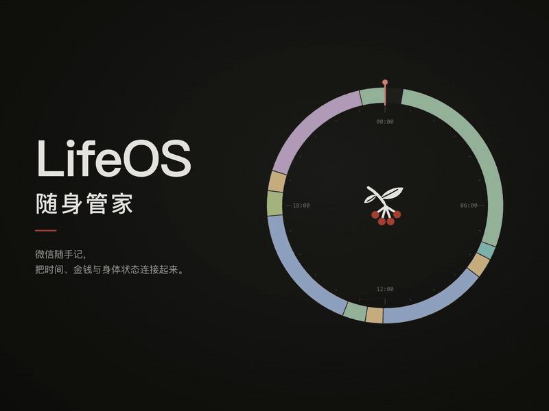
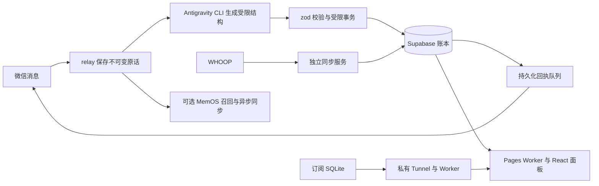

<!--
[INPUT]: 发布源码、宣传片、部署脚本与隐私访问契约。
[OUTPUT]: 中文介绍、宣传片、实现方法及完整部署流程。
[POS]: GitHub中文入口；英文版位于README.en.md。
[PROTOCOL]: 变更时更新此头部，然后检查 CLAUDE.md
-->
<p align="center">
  
</p>
<h1 align="center">LifeOS · 随身管家</h1>
<p align="center">微信随手记，把时间、金钱与身体状态连接起来。</p>
<p align="center"><strong>简体中文</strong> · <a href="README.en.md">English</a></p>
<p align="center">
  <a href="https://lifeos.zhaozimin.com">在线体验</a> ·
  <a href="https://zhaozimin.com">赵子民</a> ·
  <a href="https://ui.zhaozimin.com">纸墨朱设计系统</a>
</p>

[宣传视频](#宣传视频) · [实现方法](#实现方法) · [准备清单](#0-准备资源确认部署范围) · [完整部署流程](#完整部署流程) · [本机预览](#本机体验)

LifeOS 是一套面向个人的生活记录系统。通过微信表达正在做什么、花了多少钱或想记住什么，再回到网站查看时间轴、财务看板、订阅和健康趋势。

界面采用「纸墨朱」设计系统。Logo 取自朱砂根：墨色枝叶与朱砂红果实，也是三个面板共用的品牌母版。

## 宣传视频

<p align="center">
  <a href="docs/media/lifeos-launch.mp4"></a>
</p>

**《一天，连成一片》** · 60秒 · 1440×1080 · 含配乐，无口播。
点击动图打开[完整视频文件](docs/media/lifeos-launch.mp4)，或[直接下载 MP4](https://github.com/zhaozimin/lifeos.zhaozimin.com/raw/refs/heads/main/docs/media/lifeos-launch.mp4)。画面使用合成演示数据。视频、动图和封面均随仓库提供，见[宣传素材](docs/media/README.md)。

制作工具：[huashu-motion](https://github.com/alchaincyf/huashu-motion)。

## 能做什么

| 模块 | 能力 |
|---|---|
| 微信管家 | 记录活动与收支，支持自然问答、追问及按时段纠错 |
| 时间 | 日／周时间轴、活动切换、大类统计、历史编辑 |
| 财务 | 收支流水、财务状况、资金流量与图表钻取 |
| 订阅 | 品牌卡片、续订统计、浏览器通知及可选的七天微信提醒 |
| 健康 | WHOOP 指标、趋势、训练记录与每日运动建议 |
| 记忆 | 可选 MemOS 云端长期记忆 |
| 隐私 | 默认访客只读；本人通过密码和动态码访问私人数据 |

微信解析沿用 Antigravity CLI。该路径不要求填写独立的模型 API Key；WHOOP、MemOS 等服务仍需各自授权或凭据。

## 实现方法



- **先保存，再解析**：微信原话先入库。CLI 只生成受限 JSON，zod 校验后由数据库事务写账；模型不直接执行 SQL。
- **回复来自事实**：记账回执从已提交账本生成，经持久化队列重试。普通问答使用独立回答字段和有限上下文。
- **分域保持真源**：时间和财务在 Supabase；订阅以 VPS SQLite 为真源；WHOOP 由独立服务同步并发布健康副本。
- **服务端限定公开范围**：Pages Worker 校验会话，私有表 RLS 要求本人 AAL2；访客通过只读投影读取允许公开的字段。
- **身份与凭据隔离**：数据库服务端密钥和设备令牌留在对应后端；网站使用 publishable key 与本人会话。

入口代码：[微信接收](apps/relay/src/channel/wechat.ts) · [解析规则](apps/relay/prompts/parse.md) · [受限写入](apps/relay/src/store/supabase.ts) · [网页 Worker](apps/web/worker/index.ts) · [数据库迁移](supabase/migrations)。

## 本机体验

准备 Node.js **22.13+** 和 Python **3**，在项目根目录执行：

```sh
git clone https://github.com/zhaozimin/lifeos.zhaozimin.com.git
cd lifeos.zhaozimin.com
npm run ui
```

打开 <http://127.0.0.1:5173/dashboard/time/day>。

启动器会安装缺少的锁定依赖，并构建订阅子页。预览免登录，只使用**合成演示数据**：时间与财务保存在内存，订阅保存在临时库。重启后重置，不连接正式账本，也不会自动发布到网站。

详细编辑位置和预览行为见 [UI 美化交接](docs/UI美化交接.md)。

## 访客与本人

访客可浏览公开时间、健康指标和订阅卡片。财务保留页面与交互结构，金额、账户及私人说明显示为 `••••`；财务图表标明为示意。银行卡、原话、附件和私人备注不向访客提供。

真实金额在服务端公开投影中已移除。访客没有写入、同步或私人导出权限。本人访问使用密码、六位动态码、服务端身份检查及数据库行级权限。隐藏登录入口仅改变导航，不构成权限保障。

访问范围见 [访客访问契约](docs/访客访问.md)，检查边界见 [安全审计摘要](docs/安全审计.md)。

## 工程结构

```text
apps/relay/          微信管家、Antigravity 解析与记忆队列
apps/web/            React 面板与 Cloudflare Pages Worker
apps/whoop/          WHOOP 同步、健康分析与运动计划
apps/subscriptions/  SubOS 订阅面板与私有服务
supabase/            数据库迁移与权限测试
ops/                 本机预览、部署与加密备份工具
design/zzm/          纸墨朱设计系统锁版本
docs/                架构、操作契约与脱敏交付文档
```

技术栈：React 19 · TypeScript · Tailwind CSS · Vite · ECharts · Supabase · Cloudflare Pages / Workers · Python · SQLite。

## 完整部署流程

**当前为单用户手动部署版，没有一键安装器。登录 Antigravity 和扫码微信只是其中两步。** 每位部署者使用自己的 VPS、数据库、云账号和授权，不连接作者的生产服务。下面面向**全新实例**；升级现有实例时先备份，不要覆盖数据库或运行目录。

### 0. 准备资源，确认部署范围

| 资源 | 用途 | 当前要求 |
|---|---|---|
| Ubuntu 24.04 x86_64 VPS | 常驻接收微信、运行 CLI 和后端 | 本文脚本采用此系统及架构 |
| Supabase 项目 | 记录、权限、网站账号 | 新建独立空项目 |
| Cloudflare 账号 | Pages 网页、内部 Worker、私有连接 | 完整网页版需要 |
| Google / Antigravity 授权 | AI 解析与回答 | 需账号有可用资格、模型和额度 |
| 微信 | 扫码绑定本人会话 | 需完成手机确认 |
| WHOOP | 健康同步 | 可选，另需自己的 OAuth 应用与授权 |
| MemOS | 云端长期记忆 | 可选，另需自己的 API Key |
| 私有 R2 桶、age 密钥 | 加密备份 | 生产使用建议配置 |

本机准备 Node.js 22.13+、Python 3、Git、SSH，以及 [Supabase CLI](https://supabase.com/docs/guides/local-development/cli/getting-started)。Cloudflare CLI 随 `apps/web` 的锁定依赖安装。下文区分“本机终端”“VPS root 终端”和“VPS lifeos 会话”。先在本机执行 `ssh root@YOUR_VPS_HOST` 登录 VPS；需要 lifeos 会话时，在 VPS root 终端执行 `runuser -l lifeos`，用 `exit` 返回 root。每次打开 lifeos 会话后执行 `export PATH="/home/lifeos/.local/bin:$PATH"`。

**Antigravity 使用边界：** 当前适配器调用官方 CLI。Google FAQ 说明，个人订阅不支持把 `agy` 封装在第三方应用内；这里不承诺个人账号登录后即可获得此用途的官方支持。启用 AI 前请确认适用范围、资格和额度；暂不启用时设置 `PARSER_ENABLED=false`，先验证原话入库链路。[官方 FAQ](https://antigravity.google/docs/faq)

### 工具清单与部署顺序

| 位置 | 工具 | 用途 |
|---|---|---|
| 本机 | Git、Node.js 22.13+、npm、Python 3、SSH/SCP | 克隆、构建、合成预览与连接服务器 |
| 本机 | Supabase CLI、Wrangler（网页锁定依赖内） | 应用迁移、部署 Worker 与 Pages |
| VPS | Ubuntu 24.04 x86_64、systemd、curl、xz、util-linux | 运行专用服务、安装和会话互斥 |
| VPS | 独立安装的 Node.js 22、Antigravity CLI、Python 3 | 微信解析、健康与订阅后端 |
| VPS | cloudflared | 建立订阅内部私有连接 |
| 可选备份 | PostgreSQL 客户端、age、AWS CLI | 一致导出、加密上传与隔离恢复 |

建议顺序：**本机预览 → VPS运行环境 → Supabase及本人账号 → CLI授权 → 微信绑定 → relay → 订阅与私有连接 → Pages → 双重登录验收 → 可选集成**。
本机预览只需要第一行工具；完整云端部署需要后续云账号和授权。

### 1. 在 VPS 安装源码和运行环境

**VPS root 终端**，只在新的安装目录执行：

```sh
set -e
umask 022
apt-get update
apt-get install -y ca-certificates curl git python3 xz-utils util-linux
git clone https://github.com/zhaozimin/lifeos.zhaozimin.com.git /opt/lifeos
cd /opt/lifeos
bash ops/install-antigravity.sh
bash ops/install-node.sh
chown -R lifeos:lifeos /opt/lifeos
```

脚本创建 `lifeos` 专用用户，CLI 与 Node 安装在其主目录，不替换系统 Node。安装器和发布包有固定摘要；校验失败应审阅上游变更，不要删除校验。其他 CPU 架构需自行适配安装步骤，不能直接执行本节的 x86_64 安装器。

### 2. 创建 Supabase 数据库和本人账号

在自己的 Supabase 控制台新建空项目，保存项目地址、项目 ref、publishable key、服务端凭据和数据库密码。当前服务端配置项名为 `SUPABASE_SERVICE_ROLE_KEY`，请使用自己项目对应的服务端密钥；网站只使用 `sb_publishable_...`，不得把服务端密钥放进网页配置。

**本机终端**，进入克隆的项目根目录执行：

```sh
supabase login
supabase link --project-ref YOUR_PROJECT_REF
supabase db push --include-all --dry-run
supabase db push --include-all
```

核对 dry-run 目标是自己的空项目。当前有 `0001` 至 `0027` 共 27 个迁移；不要使用 `db reset` 操作已有生产库。也可以在 SQL Editor 按文件顺序执行全部迁移，但应自行同步迁移历史，避免日后重复应用。[CLI 说明](https://supabase.com/docs/reference/cli/supabase-db-push)

在 **Authentication → Users** 手动创建本人邮箱和密码账号，确认邮箱状态，记下用户 UUID。关闭公开注册，启用 TOTP；本地 `supabase/config.toml` 不会自动改变托管项目的认证配置。密码建议从初始化起就满足至少 20 位。

随后在 **SQL Editor** 执行下面的初始化 SQL，将 `REPLACE_WITH_OWNER_UUID` 换成该用户 UUID。它只建立公开模板分类、未分类兜底和关闭状态的访客配置，不导入作者记录。首次安装关闭 WHOOP 时间校准；稍后连接设备后再启用。已有时间分类不会被重置。

```sql
do $$
declare
  v_owner uuid := 'REPLACE_WITH_OWNER_UUID'::uuid;
begin
  if not exists(select 1 from auth.users where id=v_owner) then
    raise exception 'Create the Auth user first';
  end if;
  if exists(select 1 from public.visitor_settings where id=1 and owner_id<>v_owner) then
    raise exception 'This database belongs to another owner';
  end if;
  if not exists(select 1 from public.categories where owner_id=v_owner and kind='time') then
    perform public.install_time_groups(v_owner, repeat('0',64),
      '[{"code":"time-group-work","name":"工作","nature":"core"},
        {"code":"time-group-learning","name":"学习成长","nature":"core"},
        {"code":"time-group-personal","name":"生活自理","nature":"support"},
        {"code":"time-group-food","name":"饮食","nature":"recovery"},
        {"code":"time-group-rest","name":"清醒休息","nature":"recovery"},
        {"code":"time-group-sleep","name":"睡眠","nature":"recovery"},
        {"code":"time-group-exercise","name":"运动","nature":"recovery"},
        {"code":"time-group-leisure","name":"娱乐","nature":"leisure"},
        {"code":"time-group-social","name":"私人社交","nature":"leisure"},
        {"code":"time-group-travel","name":"出行","nature":"support"},
        {"code":"uncategorized","name":"待确认","nature":"support"}]'::jsonb,
      '[]'::jsonb, true);
    update public.time_group_policies set sleep_authority=false where owner_id=v_owner;
  end if;
  insert into public.categories(owner_id,kind,code,name,nature)
    values(v_owner,'time','uncategorized','待确认','support')
    on conflict(owner_id,kind,code) do nothing;
  insert into public.categories(owner_id,kind,code,name,direction) values
    (v_owner,'money','uncategorized','待确认',null),
    (v_owner,'money','food','餐饮','expense'),
    (v_owner,'money','transport','交通','expense'),
    (v_owner,'money','software','软件与工具','expense'),
    (v_owner,'money','living','生活消费','expense'),
    (v_owner,'money','income','收入','income')
    on conflict(owner_id,kind,code) do nothing;
  insert into public.visitor_settings(id,owner_id,enabled,share_activity_titles)
    values(1,v_owner,false,false) on conflict(id) do nothing;
end;
$$;
```

### 3. 登录 Antigravity，并验证模型调用

**本机终端**，将 `YOUR_VPS_HOST` 换成自己的服务器：

```sh
ssh -t root@YOUR_VPS_HOST 'runuser -l lifeos -w SSH_CONNECTION,SSH_CLIENT,SSH_TTY,TERM -c "cd /var/lib/lifeos/parser-workspace && exec /home/lifeos/.local/bin/agy"'
```

按终端输出在本人浏览器完成官方授权、必要的账号验证和首次设置。凭据留在 VPS 的专用用户目录，不复制作者或其他人的登录文件。查看该账号实际可用的模型；后面的 `AGY_MODEL` 必须使用已验证可用的模型 ID，示例默认值不保证适用于所有账号。

**VPS lifeos 会话**，验证无界面调用：

```sh
cd /var/lib/lifeos/parser-workspace
/home/lifeos/.local/bin/agy -p "Reply only ok. Do not use tools." --output-format json --print-timeout 60s
```

确认正常退出且返回成功结果，再启用解析器。账号资格、模型额度或授权失败时，先解决 CLI 问题，不要通过跳过权限或轮换账号绕过限制。详细步骤见 [Antigravity 运维](ops/antigravity.md)。

### 4. 生成二维码并绑定微信

**VPS lifeos 会话**，确保使用刚安装的 Node：

```sh
export PATH="/home/lifeos/.local/bin:$PATH"
cd /opt/lifeos/ops
npm ci --ignore-scripts
npm run prepare:wechat
mkdir -p /var/lib/lifeos/wechat
chmod 700 /var/lib/lifeos/wechat
flock -n /var/lib/lifeos/wechat/login.lock node wechat-login.mjs
```

保持此终端运行。另开一个**本机终端**取回图片：

```sh
scp root@YOUR_VPS_HOST:/var/lib/lifeos/wechat/login-qr.png ./lifeos-login-qr.png
```

打开本机 PNG，用微信扫一扫并在手机确认；需要配对码时按扫码终端提示操作。状态可在 VPS 查看 `/var/lib/lifeos/wechat/login-status.json`，`bound` 才表示成功。二维码更新后重新复制最新图片，绑定后删除本机二维码。

**扫码脚本只保存会话，尚不会接收和回复消息。** 同一机器人只运行一个接收器；重新绑定前停止旧 relay。详细状态见 [微信绑定](ops/wechat.md)。

### 5. 配置并启动微信管家

**VPS root 终端**：

```sh
cd /opt/lifeos
install -d -m 0700 /etc/lifeos
install -m 0600 apps/relay/.env.example /etc/lifeos/relay.env
```

用终端编辑器填写 `/etc/lifeos/relay.env`：

| 配置 | 填写内容 |
|---|---|
| `SUPABASE_URL` | 自己的项目地址 |
| `SUPABASE_SERVICE_ROLE_KEY` | 仅服务端使用的项目密钥 |
| `OWNER_AUTH_ID` | 第 2 步创建的本人 UUID |
| `AGY_BIN`、`AGY_WORKSPACE` | 使用模板中的专用用户路径 |
| `AGY_MODEL` | 第 3 步验证可用的模型 ID |
| `PARSER_ENABLED` | 已完成授权及适用范围确认后为 `true`；原话模式为 `false` |
| `MEMOS_ENABLED` | 暂不接入记忆时保持 `false` |

然后运行：

```sh
bash /opt/lifeos/ops/deploy-relay.sh
systemctl is-active lifeos-relay.service
journalctl -u lifeos-relay.service -n 30 --no-pager
```

部署脚本构建 relay、同步管家规则到工作区 `AGENTS.md`，再由 doctor 检查账号、分类、迁移和 CLI。检查失败会阻止启动。需要调整管家规则时修改 `apps/relay/prompts/parse.md`，再运行部署脚本，不能只改工作区副本。

### 6. 部署订阅后端

**完整网页版需要第 6–8 步。当前登录限流与订阅内部 Worker 共用服务绑定；即使暂不使用订阅数据，也不能省略整个内部 Worker。** 它的部署模板还需要自己的 VPC Service ID。

先在 **VPS lifeos 会话**构建订阅静态页：

```sh
export PATH="/home/lifeos/.local/bin:$PATH"
cd /opt/lifeos/apps/subscriptions/web
npm ci
npm run build:standalone
```

随后在 **VPS root 终端**准备独立运行账号。以下命令用于首次安装；若账号、目录或 `runtime` 已存在，先核对，不要删除旧数据：

```sh
useradd --system --user-group --home-dir /var/lib/lifeos-subscriptions --no-create-home --shell /usr/sbin/nologin lifeos-subscriptions
install -d -m 0755 /opt/lifeos-subscriptions/server
cp -a /opt/lifeos/apps/subscriptions/server/. /opt/lifeos-subscriptions/server/
install -d -m 0700 -o lifeos-subscriptions -g lifeos-subscriptions /var/lib/lifeos-subscriptions
test ! -e /opt/lifeos-subscriptions/server/runtime
ln -s /var/lib/lifeos-subscriptions /opt/lifeos-subscriptions/server/runtime
install -m 0644 /opt/lifeos/ops/lifeos-subscriptions.service /etc/systemd/system/lifeos-subscriptions.service
systemctl daemon-reload
systemctl enable --now lifeos-subscriptions.service
curl --fail http://127.0.0.1:18787/v1/health
```

空 SQLite 库由服务自行建表；不会复制作者的订阅、账号或银行卡。`runtime` 符号链接让图标和卡面写入可写状态目录；不要直接把服务改成公网监听。接入契约见 [订阅接入](docs/订阅接入.md)。

### 7. 建立 Cloudflare 私有连接和内部 Worker

在自己的 Cloudflare 账号按 [Workers VPC 指南](https://developers.cloudflare.com/workers-vpc/get-started/) 建立 Tunnel，在 VPS 安装并运行官方 `cloudflared` 连接器，确认 Tunnel 在线。VPC 连接要求允许出站 QUIC；具体版本和网络要求以 [Tunnel 文档](https://developers.cloudflare.com/workers-vpc/configuration/tunnel/) 为准。

创建 **HTTP 类型 VPC Service**：选择该 Tunnel，目标地址 `127.0.0.1`，HTTP 端口 `18787`。保存自己的 Service ID。**不创建公开域名路由，不开放 VPS 的 18787 入站端口。** 不要使用临时公开 Tunnel 地址替代私有连接。

**本机终端**，先进入本机克隆的项目根目录，再安装网页工具并登录 Cloudflare：

```sh
cd apps/web
npm ci
npx wrangler login
cd ../subscriptions/edge
cp wrangler.example.toml wrangler.toml
```

编辑本机 `wrangler.toml`：把 `REPLACE_WITH_VPC_SERVICE_ID` 替换为自己的 ID，为 `namespace_id` 选择本账号内未用于其他策略的正整数。保持 `workers_dev=false`、`preview_urls=false`，以及限流绑定 `AUTH_LIMITER`。

然后部署：

```sh
../../web/node_modules/.bin/wrangler deploy
```

默认 Worker 名为 `lifeos-subscriptions`。它必须与 `apps/web/wrangler.toml` 中 `SUBSCRIPTIONS` 的 `service` 一致。此本机生产配置已被 Git 忽略，不应提交。连接器可以使用官方安装的服务；若改用本仓库的 `lifeos-subscriptions-tunnel.service`，需另建其专用用户，并准备单元声明的二进制和 token 文件，不能直接复制一个缺少前置条件的单元。

### 8. 部署 Cloudflare Pages 网页

**本机终端**，接着上一步，从 `apps/subscriptions/edge` 进入 `apps/web`。把 `wrangler.toml` 的 `name` 改成自己选择的 Pages 项目名，例如 `lifeos-yourname`。保留 `SUBSCRIPTIONS` 服务绑定；若重命名内部 Worker，更新该绑定。

```sh
cd ../../web
export LIFEOS_PAGES_PROJECT=lifeos-yourname
npx wrangler pages project create "$LIFEOS_PAGES_PROJECT" --production-branch main
npx wrangler pages secret put SUPABASE_URL --project-name "$LIFEOS_PAGES_PROJECT"
npx wrangler pages secret put SUPABASE_PUBLISHABLE_KEY --project-name "$LIFEOS_PAGES_PROJECT"
npx wrangler pages secret put OWNER_AUTH_ID --project-name "$LIFEOS_PAGES_PROJECT"
npx wrangler pages secret put OWNER_EMAIL --project-name "$LIFEOS_PAGES_PROJECT"
npm run build
npx wrangler pages deploy dist --project-name "$LIFEOS_PAGES_PROJECT" --branch main
```

项目名需要在自己的账号可用；上面的名称只是示例。四个 Secret 按提示输入自己的值，禁止填写 `service_role` 密钥。`OWNER_EMAIL` 与第 2 步的 Auth 用户一致，不能填作者邮箱。配置变化后重新部署。Wrangler 文件中的绑定是配置的一部分，不能只上传 HTML 或 ZIP 就认为完整部署成功。[Pages 配置说明](https://developers.cloudflare.com/pages/functions/wrangler-configuration/)

先使用部署返回的 `https://...pages.dev` 地址，也可以随后绑定自己的 HTTPS 域名。需要晨间微信消息中的网站链接时，将 `apps/whoop/server/cloud.mjs` 内的实例链接改成自己的域名；当前该链接尚未由通用环境变量控制。作者品牌和推广链接不需要因此替换。

### 9. 首次登录、设置个人数据并验收

手动打开**自己网站**的 `/dashboard/login`。使用第 2 步的账号密码，按页面完成首次密码设置和验证器绑定。访客界面不显示登录入口，Google 授权也不能代替此网站账号。

进入时间设置检查分类，在财务设置创建自己的支付账户、分类和预算，再开始记账。不要复制作者的真实账户或余额。

默认访客公开权限仍为关闭。确认愿意公开哪些数据后，才在 SQL Editor 执行以下语句；保留原始活动标题隐藏。要关闭公开访问，把 `enabled` 改为 `false`。

```sql
update public.visitor_settings
set enabled=true, share_activity_titles=false
where id=1 and owner_id='REPLACE_WITH_OWNER_UUID'::uuid;
```

上线验收：

- 在微信发“帮助”，再描述自己实际正在做的事，最后发“停止计时”；核对回执与网页。
- 未启用解析器时应明确提示原话入库，不能当成 AI 问答已经接通。
- 未登录请求私人 `/api/dashboard` 应为 401；只完成密码、未验证动态码时应为 403。
- 使用未登录浏览器检查公开范围，金额和账号应打码，访客不能新增、保存、同步或下载私人数据。
- WHOOP 未接通时健康数据尚不可用；仅有建表或网页静态资源不代表健康接入完成。

### 10. 按需接入 WHOOP、MemOS 和备份

**WHOOP：** 创建自己的开发者 OAuth 应用，配置 Client ID、Client Secret 和与实际应用一致的回调地址。VPS 配置中的默认回调为 `http://localhost:3210/api/whoop/callback`；按开发者平台当前要求配置 HTTPS 或本机回调。[WHOOP OAuth](https://developer.whoop.com/docs/developing/oauth/)

**VPS root 终端**，首次安装健康服务：

```sh
useradd --system --user-group --home-dir /var/lib/lifeos-whoop --no-create-home --shell /usr/sbin/nologin lifeos-whoop
install -d -m 0755 /opt/lifeos-whoop /usr/local/lib/lifeos-whoop
cp -a /opt/lifeos/apps/whoop/. /opt/lifeos-whoop/
install -m 0755 /home/lifeos/.local/bin/node /usr/local/lib/lifeos-whoop/node
install -d -m 0700 -o lifeos-whoop -g lifeos-whoop /var/lib/lifeos-whoop
install -m 0600 /opt/lifeos/apps/whoop/.env.example /etc/lifeos/whoop.env
```

编辑 `whoop.env`，填写自己的 Supabase 地址、服务端密钥和同一 `OWNER_AUTH_ID`，保留 `DATA_DIR=/var/lib/lifeos-whoop`，并增加自己的 `WHOOP_CLIENT_ID`、`WHOOP_CLIENT_SECRET`。然后安装单元并启动：

```sh
install -m 0644 /opt/lifeos/ops/lifeos-whoop.service /etc/systemd/system/lifeos-whoop.service
systemctl daemon-reload
systemctl enable --now lifeos-whoop.service
```

在**本机终端**建立 `ssh -N -L 3210:127.0.0.1:3210 root@YOUR_VPS_HOST`，打开 `http://localhost:3210` 完成本人 WHOOP 授权，再核对云端健康页面。只运行一个令牌刷新进程。确认已获得有效睡眠数据后，在 SQL Editor 为自己的 `time_group_policies` 设置 `sleep_authority=true`，才启用夜间和午睡的时间轴校准。完整语义见 [健康接入](docs/健康接入.md) 与 [睡眠规则](docs/时间分类与睡眠规则.md)。

**MemOS：** 申请自己的云端 Key，在 VPS 创建 root 所有、0600 权限的 `/etc/lifeos/memos.env`，填入：

```dotenv
MEMOS_ENABLED=true
MEMOS_API_KEY=REPLACE_WITH_YOUR_MEMOS_KEY
MEMOS_AGENT_ID=lifeos-butler
```

重启 `lifeos-relay.service`，确认日志中 `memory_enabled=true`。不启用时保持 `MEMOS_ENABLED=false` 即可，基础记录和问答不依赖 MemOS。详情见 [云记忆运维](ops/memory.md)。

**加密备份：** 创建自己的私有 R2 桶；仅把 age 公钥交给 VPS，解密私钥留在自己的离线安全位置。按 [备份运维](ops/backup.md) 准备专用只读数据库账号、`/etc/lifeos-backup/backup.env`、`pgpass` 和 `recipients.txt`；这些不会由 relay 自动创建。

在 Ubuntu 24.04 x86_64 VPS 上运行 `bash /opt/lifeos/ops/install-backup-tools.sh` 安装备份工具。`backup.env` 需要自己的 `LIFEOS_PROJECT_REF`、`LIFEOS_AGE_RECIPIENTS=/etc/lifeos-backup/recipients.txt`、`LIFEOS_R2_BUCKET`、`LIFEOS_R2_ENDPOINT`、数据库 `PGHOST/PGPORT/PGDATABASE/PGUSER` 以及限桶的 `AWS_ACCESS_KEY_ID/AWS_SECRET_ACCESS_KEY`。数据库密码放在 `pgpass`，均按备份服务账号配置权限。凭据齐备后运行 `bash /opt/lifeos/ops/deploy-backup.sh`；首次备份确认成功才启用定时器。至少做一次隔离恢复验证，订阅 SQLite 另按订阅备份单元配置。

### 11. 按需启用订阅七天微信提醒

完成订阅服务、微信绑定、relay启动和27个迁移后，在 **VPS root 终端** 执行：

```sh
install -m 0644 /opt/lifeos/ops/lifeos-subscription-reminders.service /etc/systemd/system/
install -m 0644 /opt/lifeos/ops/lifeos-subscription-reminders.timer /etc/systemd/system/
systemd-analyze verify /etc/systemd/system/lifeos-subscription-reminders.service /etc/systemd/system/lifeos-subscription-reminders.timer
systemctl daemon-reload
systemctl enable --now lifeos-subscription-reminders.timer
systemctl start lifeos-subscription-reminders.service
systemctl list-timers lifeos-subscription-reminders.timer
```

该任务在北京时间09至21点整点检查七天后扣款的自动续订项。先给机器人发一条消息建立有效上下文；扫码成功不能代替聊天上下文。提醒复用现有回执队列，不扣款、不创建财务流水。浏览器通知保持独立。核对与停用方法见[订阅扣款提醒](ops/subscription-reminders.md)。

### 常见卡点

| 现象 | 先检查什么 |
|---|---|
| 安装脚本提示摘要变化 | 官方安装器或包已更新，先审阅，不删除校验 |
| doctor 提示账号或兜底分类缺失 | 27 个迁移、Auth UUID、初始化 SQL 和 relay.env 是否指向同一项目 |
| 二维码看不到或过期 | 取回最新 `login-qr.png`，保持扫码进程运行并完成手机确认 |
| 扫码成功但微信不回复 | relay 是否运行、是否误开第二个轮询器、解析器是否关闭 |
| Google 登录成功但模型失败 | 实际可用模型、账号资格、额度和 SSH 授权状态 |
| 网站登录提示保护不可用 / 503 | 内部 Worker、`SUBSCRIPTIONS` 绑定、四个 Secret 及部署版本 |
| 访客页无数据 / 403 | 公开开关默认关闭；手动登录本人页或核对自己的公开配置 |
| 订阅无法连接 | Tunnel 在线状态、QUIC 出站、VPC 角色、目标端口和自己的 Service ID |
| 健康暂无数据 | WHOOP 授权、独立服务、发布配置和同步结果 |

这份流程描述现有手动部署路径，不等于已完成全新账号的一键安装演练。不要把“构建成功”“扫码成功”或“Google 登录成功”单独作为整套系统上线的验收结果。

## 隐私和发布

不要把 `.env`、令牌、数据库、真实记录或解密私钥提交到 Git。仓库分发源码、配置模板与合成数据；生产资源编号和完整运维记录留在本机私有目录。作者品牌、Logo、公开网站和产品链接保留。

升级前备份自己的数据库、SQLite、会话和生产配置，阅读新增迁移，再更新代码并分别重建各服务。不要用演示数据库或作者的备份覆盖自己的实例。发布边界见 [仓库发布与脱敏](docs/仓库发布与脱敏.md)。

## 开源许可

源码按 [MIT License](LICENSE) 发布。第三方依赖与品牌素材保留各自的权利和许可。
