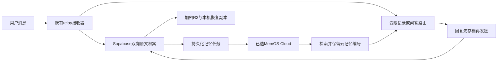

<!--
[INPUT]: 用户选定MemOS云、官方接入文档与现有微信收发边界。
[OUTPUT]: 云API契约、双向档案、凭据边界和脱敏结论。
[POS]: P5研究与运行边界；当前仅接LifeOS微信。
[PROTOCOL]: 变更时更新此头部，然后检查 CLAUDE.md
-->
# MemOS接入研究

研究日期：2026-10-25；启用核验：2026-10-26。
研究对象为MemTensor的MemOS。
它与usememos的笔记应用是不同产品。
用户已明确选择MemOS官方云服务。
快速开始入口为[本人指定页面](https://memos-dashboard.openmem.net/cn/quickstart/?source=landing)。
首批为LifeOS微信，其他入口等待范围选择。
云API代码集成已上线，后台同步与回答前检索已启用。
云凭据仅保留在私有文件和VPS服务环境。
既有用户消息与助手回复已按角色同步并核对。
新回复按修订归档，渠道接受后进入记忆队列。
其他AI应用尚未接入，不自动采集本次开发对话。

## 结论

选择“代码集成”，由现有relay调用MemOS云API。
双向档案和持久化云同步已经接通。
原始正文继续以现有Supabase为唯一真源。
R2保存加密归档，本机保留解密能力和恢复副本。
MemOS云保存上传的对话副本和提炼记忆。
VPS只运行归档、同步和检索适配器。
电脑休眠不应中断微信记录和记忆召回。
不在VPS安装MemOS、Neo4j或Qdrant。
此选择落实用户最新要求；自托管章节仅保留比较证据。

“云端”需区分现有Supabase、自有VPS和MemOS托管云。
前两项已是本项目的数据基础设施。
MemOS托管云会新增一个接收对话的服务提供方。
数据在自有VPS不等于数据物理上只在本机。

## 容量复核与长期保留提案

实例容量、消息字节数和表占用仅存私有验收。
部署者应分别监测业务表、索引、WAL与日志。
数据库额度与磁盘只读门槛是不同限制。
按账号当前套餐核对配额，不从公开示例推断本人用量。
见[官方价格](https://supabase.com/pricing)
和[数据库与磁盘](https://supabase.com/docs/guides/platform/database-size)。

正常记录不会消耗一个按条数计算的数据库寿命。
需要监测的是容量、读写负载、增长率和服务配额。
举例：每天100轮、每轮2条、每条平均2KB，
一年正文约146MB；这不含索引、版本、附件和备份。
长篇AI回复和附件会显著改变这个估算。

MemOS会提炼、合并和更新记忆，也有历史消息接口。
召回若干记忆不等于取回逐字原文和全部回复版本。
因此建议保留一份独立原文，供核对和重建。
原文保留不要求所有全文永久驻留Supabase。

长期可采用以下分层，当前尚未实施：

- Supabase保留精确账目、消息索引、同步状态与近期正文。
- R2保存较旧对话的完整原文归档，索引保存摘要与校验值。
- MemOS Cloud负责记忆生产和召回。
- 本机保留可恢复副本，避免只有一份云端档案。

近期保留90天可作为初始提案，须结合实际增长率确定。
达到设定的容量水位前，先评估归档或调整配额。
原文归档必须使用独立前缀和保留策略。
现有daily备份只保留30天，不能代替永久对话档案。
归档后须核对条数、校验值、读取权限与恢复能力。
既有raw_inputs保持不可变，不自动删除或清空。
新对话正文的归档方式须在实现前更新契约与恢复工具。
容量治理尚未移动、压缩或删除线上正文。
0020新增消息档案和同步队列，不清理既有原话。

## 代码集成与Agent接入

两种方式都可使用同一个MemOS云服务。
它们区分调用入口，不区分本地和云端部署。

| 入口 | 工作方式 | 本项目选择 |
|---|---|---|
| 代码集成/API或SDK | relay固定执行上传、检索、重试与归档 | 首批主路径，覆盖所有程序收发 |
| Agent插件 | 在已适配框架的生命周期自动读写 | 本项目没有运行OpenClaw，不执行其安装脚本 |
| MCP | 为客户端提供记忆读写工具 | 后续让其他客户端调用同一记忆 |
| CLI与Skill | Agent按规则执行记忆命令 | 可辅助研究；不替代完整消息采集 |

官方把API/SDK用于自研Agent、Chatbot和业务应用。
CLI安装目标列表未列出Antigravity。
不能把OpenClaw插件命令直接套进当前VPS。
见[在Agent中使用](https://memos-docs.openmem.net/cn/memos_cloud/getting_started/agent_usage/)。

在控制台选择代码集成，获取HTTP/API接入信息。
无需把现有回答模型切换为MemOS Chat API。
当前Gemini 3.8和官方agy授权继续使用。

### 具体调用顺序

1. 用户消息先写raw_inputs，档案只保存其引用。
2. relay按用户和Agent范围调用`/search/memory`。
3. 将命中记忆连同来源作为数据交给agy。
4. 保存回复正文，再使用既有微信队列投递。
5. 后台按消息提交`/add/message`，assistant仅在渠道确认后上传。
6. 保存task_id，查询`/get/status`直到完成。

每条消息单独保存时间；不合并或改写原文。
启用后的确认回执也归档，通用提示不作为用户事实。
云写入默认异步，不阻塞微信接收和原话保存。
检索超时降级到当前消息与既有受限上下文。
云端失败由持久化任务补偿，不丢本地真源。

### 身份与会话映射

- `user_id`：`lifeos:`加本人Auth UUID，跨会话保持一致。
- `agent_id`：首批固定`lifeos-butler`，区分后续Agent。
- `conversation_id`：`lifeos-wechat:`加原话的上海日期。
- `messages[].role`：明确`user`或`assistant`。
- `messages[].chat_time`：原始发生时间，导入不改成今天。
- `info`：关联自有message_id与批次编号，不上传OAuth载荷。

同一用户的跨Agent共享按检索范围显式开启。
多客户端使用同一账号API Key不自动保证身份映射一致。
不能用随机user_id测试后宣称长期记忆可用。

### 云端接入凭据

在控制台为LifeOS创建项目并取得独立API Key。
服务端使用`Authorization: Token <MEMOS_API_KEY>`。
API基址为`https://memos.memtensor.cn/api/openmem/v1`。
Key只进入VPS私有环境，不进入网页、Git或聊天正文。
现有agy子进程环境白名单不传递此Key。
MemOS请求由relay执行，不让模型自行读取凭据。
当前官方流程见[应用集成](https://memos-docs.openmem.net/memos_cloud/getting_started/quick_start/)。

当前凭据已由本人填写，本机文件为LifeOS凭据目录下memos.env。
VPS文件为`/etc/lifeos/memos.env`，root所有，权限0600。
服务已装载MEMOS_ENABLED=true，云鉴权已验证。
后续只输出检查结果，不显示Key。

## 产品与部署比较

| 方案 | 组件与数据位置 | 适配本项目的判断 |
|---|---|---|
| Memos笔记应用 | 自托管笔记数据库，支持REST接口 | 可做笔记展示；不直接解决AI记忆生产 |
| MemOS Cloud | 官方托管记忆，应用调用API | 用户已选定；主路径为relay代码集成 |
| MemOS完整服务 | Python API、Neo4j、Qdrant及模型后端 | 控制完整；运维与资源成本最高 |
| MemOS轻量插件 | Node、SQLite、本地向量与可选LLM | 本轮不选；尚无本项目现成适配器 |
| 只做完整对话档案 | 现有relay、Supabase、R2 | 先完成；无需增加模型调用 |

MemOS云和开源方案均提供长期记忆能力。
它们的接入、存储和运维责任不同。
官方比较见[云与开源](https://memos-docs.openmem.net/memos_cloud/getting_started/cloud_and_opensource/)。
笔记产品边界见[Memos官网](https://usememos.com/)。

## 当前代码的真实缺口

`channel/wechat.ts`接收本人发给机器人的消息。
`saveRaw`先保存原话，再推进微信接收游标。
`raw_inputs`保留原话和完整渠道载荷。
这是已有能力，不需要重复建一套接收器。

旧版`raw_inputs.receipt_text`只保存当前回执。
解析、追问和重试会改变回执修订号。
现有SQL会清空旧回执，再生成下一版。
因此当前表不能证明每一版回复都完整留存。
`worker.ts`发送后只标记当前回执的投递时间。
0020现已保存每版回复正文与首次渠道确认。
逐次HTTP投递事件仍未单独建表。

`runner.ts`接收agy的JSON信封。
它解码返回，不持久化每次模型运行的完整输出。
`parse_result`保留校验后的业务计划。
微信可见回执由`reply.ts`依据账本生成。
模型JSON与用户可见回复必须分开标注。

原微信只执行受限记录，提问会退回存档回执。
0019对话修复增加answer与最近八轮上下文。
普通问答继续使用官方agy，不替换账目事务。
0020进一步接通MemOS，并捕获启用后的每版回执。

## 应当完整保存什么

| 对象 | 保存方式 | 边界 |
|---|---|---|
| 用户消息 | 一条消息一份不可变正文 | 保留来源编号、会话、时间和角色 |
| 机器人回复 | 发送前保存每一版正文 | 确认、追问、最终回复和晨报分别留存 |
| 投递事件 | 追加尝试、接受、失败或未知事件 | 渠道接受不等于本人已读 |
| 模型运行 | 如需审计，单独关联运行编号 | 不把后台JSON伪装成曾发出的回复 |
| 附件 | 正文关联私有附件编号 | 当前微信仅取到文字，二进制须另接入 |
| 记忆 | 提炼事实、偏好和事件，指向原始消息 | 保留角色、来源和冲突状态 |

接入点必须在程序收发边界。
只在元提示词写“记住所有消息”不能保证完整。
历史回填只使用现存原话和仍保留的回执。
无法恢复已被覆盖的旧回执时，标记缺失。
不得用当前模型重新编写历史回复。
全量归档的验收从新归档器上线时开始。

## 建议的数据契约

以下两张表已创建并启用本人AAL2读取。

- `conversation_messages`：用户原文引用与不可变回复正文。
  保存归属、原话编号、角色、修订、发生时间和首次渠道确认。
  用户消息按渠道编号去重，回复按输入编号和修订号去重。
- `memory_jobs`：每条消息对应一项持久化云同步任务。
  保存任务编号、租约、重试状态与完成时间。

message_events逐次投递日志尚未实施。
当前不以重试次数推断用户是否已读。

机器人先写回复正文，再调用既有渠道发送。
发送重试复用原消息编号，不重新生成正文。
渠道超时仍有外部结果不明窗口。
数据库去重不能单独保证渠道绝对只投递一次。
正文表要求本人AAL2读取，浏览器不能直接写底表。
服务端追加接口校验归属和幂等键。
新增表必须进入备份计数和隔离恢复验收。

## 记忆如何进入下一轮对话

全量正文负责可追溯，记忆负责减少后续上下文。
检索只附带少量命中内容，不拼接全部历史。
记忆后端不可用时继续保存和发送正常记录回执。
后台恢复后从持久化检查点补齐记忆。
记忆不是资金账户、钟点和金额的事实输入。
账目仍只接受原话与现有受限数据库上下文。

用户陈述和AI建议分别标记角色。
AI猜测不能转成已确认的用户事实。
冲突记忆保留来源，订正后标记旧结论失效。
检索文本作为数据，不得覆盖系统规则或调用权限。
召回保留云记忆编号及接口提供的会话编号。
上传info包含自有消息编号，不假定检索总会返回它。

## 云服务核查

云服务支持`user`和`assistant`消息。
`conversation_id`划分会话，`agent_id`标识Agent。
历史导入需提供`chat_time`，避免全部记成导入当天。
见[Add Message](https://memos-docs.openmem.net/memos_cloud/mem_operations/add_message/)。

写入使用`POST /add/message`，检索使用`POST /search/memory`。
后台异步任务返回task_id后，还需核查`get/status`。
接口接受任务不等于提炼已经完成。
见[异步模式](https://memos-docs.openmem.net/memos_cloud/features/async_mode/)。

云端也有`/get/message`历史接口。
当前文档默认取6条，单次最多50条。
此接口不构成全量导出和长期保真的独立证明。
保留自有原文档案后，才能稳定重建或更换后端。
见[Get Message](https://memos-docs.openmem.net/api_docs/message/get_message/)。

官网当前展示Free为每月5万次add、2万次search。
Starter标注当前免费、原价19美元每月。
Pro标注当前免费、原价286美元每月。
这是网页展示，不是已取得的永久报价或本人额度。
注册后仍需核对账号实际配额和促销有效期。
当前限制页为每次输入4万token、每分钟40万token。
旧dashboard页面仍有8k版本，实施以当前接口校验为准。
见[官网价格](https://memos.openmem.net/)和[现行限制](https://memos-docs.openmem.net/memos_cloud/support/limit/)。

云接口需要独立MemOS API Key，保存在VPS私有环境。
它与Gemini模型API Key是不同凭据。
使用记忆云API不要求把回答模型改成MemOS Chat API。
本项目仍可由官方agy生成回答。
用户已选择MemOS云，正式微信文字同步已启用。

### 公开条款的关键边界

官网当前协议发布日期为2025-06-23。
第4.3条对生成内容的授权包含模型训练等用途。
第5.1条还描述服务改进与关联公司共享。
不能将“生成内容”直接扩大解释为全部输入。
也不能据此承诺私人输入和派生记忆均不用于训练。
存储地域、训练退出、原文导出和备份删除时限仍待确认。
上述是公开条款事实，不改变用户已选云服务的决定。
完整正文仍保存在自有档案中，便于导出与更换后端。
见[公开协议4.3与5](https://memos-dashboard.openmem.net/agreement/)。

## 自托管比较记录（本轮不采用）

VPS资源与既有服务清单仅存私有运维记录。
部署前实测可用内存、磁盘与峰值负载。
自托管评估不得影响既有服务和网络规则。

### 完整服务

官方Compose启动MemOS API、Neo4j和Qdrant。
还需配置记忆抽取模型、向量模型和重排后端。
自托管存储不会自动消除外部模型调用。
官方同时支持Ollama等本地后端。
同机运行本地模型的延迟与峰值内存需要实测。
见[REST服务部署](https://memos-docs.openmem.net/open_source/getting_started/rest_api_server/)
和[模型后端](https://memos-docs.openmem.net/open_source/modules/model_backend/)。

官方示例Compose名为memos-dev。
示例对外映射数据库端口，并含示例数据库密码。
不能把示例原封不动用作LifeOS生产配置。
生产应固定版本，只向回环暴露记忆API。
图数据库和向量库仅在私有网络互通。
使用独立用户或容器权限、私有配置和资源上限。
保留既有业务服务和网络规则。
本轮没有执行Compose，也没有安装Docker。

### 轻量插件

官方轻量核心使用SQLite，有FTS5和向量检索。
当前现成适配面向OpenClaw、Hermes和DeepSeek Harness。
它是Agent插件，不是安装即用的独立通用CLI。
本项目的relay和Antigravity需要独立适配。
不为记忆功能改换整套Agent框架。
官方说明见[轻量插件固定版本源码](https://github.com/MemTensor/MemOS/tree/adcb9f270c982f2b9ff8db9714792829d3bd6ab8/apps/memos-local-plugin)。

源码允许无LLM时保留轻量轨迹，反思提炼会降级。
复用DSH模型授权的能力不能套用到agy。
如继续不增加模型API Key，需验证agy抽取适配器。
向量可评估本地模型，避免把正文交给外部embedding服务。
此适配尚未实现，不能宣称无密钥完整即用。

固定源码中的匿名统计发送默认开启，支持配置关闭。
官方声明统计不含原文；上线仍需显式关闭并核查出站。
见[telemetry说明](https://github.com/MemTensor/MemOS/blob/adcb9f270c982f2b9ff8db9714792829d3bd6ab8/apps/memos-local-plugin/core/telemetry/README.md)。
模型、embedding、遥测和更新检查应分别列出数据去向。
“SQLite在VPS”本身不足以证明没有其他出站。

研究固定仓库修订为`adcb9f270c982f2b9ff8db9714792829d3bd6ab8`。
该修订日期为2026-10-23；并非推荐未经验证直接投产。

## 其他AI入口

MemOS只有收到对话后，才能为这些对话产生记忆。
MCP提供读写工具，不自动保证每轮双方都被采集。
跨应用要逐一接收导出、官方事件或应用自己的日志接口。
采集适配器先写同一个原文契约，再异步生成记忆。
历史导入保留来源、角色、分支和原始时间。
跨应用同一段复制文本不能只按正文合并。
聊天内容相同不等于同一条渠道消息。
当前没有接入ChatGPT、Claude或Codex的全量对话采集。

## 启用验收与剩余任务

0020已应用，既有消息与回复已按来源和角色核对。
云接口的引号及换行差异按显式规则核对。
完整格式以自有原文和加密备份为准。
实际批次、消息数量和恢复统计仅存私有验收。
程序与数据库检查通过，不替代真实收件核对。

隔离云身份验证写入、任务完成和跨会话召回。
官方agy在最近对话为空时使用召回记忆回答。
此探针不向微信发送消息，不写入本人云身份。
异常测试覆盖检索失败降级、任务恢复和结果不明禁重投。
来源、角色、原时间与消息编号进入上传契约。
记忆不能补造账目账户，也不能充当工具指令。

已从R2下载发布后归档，并实际隔离恢复。
消息档案与同步任务已逐项恢复核对。
本人AAL2、AAL1、异主和匿名权限检查通过。
原话与助手正文不可变检查通过。
任务completed只表示提炼完成，不保证每句产生新记忆。
详情与启停方法见[云记忆运维](../ops/memory.md)。

微信真实新消息的收件与跨日召回继续观察。
旧版被覆盖的回复无法由当前回执补回。
逐次HTTP投递事件尚未实现。
system来源的晨报不进入本批云上传。
对话专页、检索和原文导出尚未实现。
ChatGPT、Claude、Codex等客户端尚未接入。
R2长期冷归档尚未实现，daily副本仍保留30天。
后续入口复用身份契约，并分别核验双向采集。

[PROTOCOL]: 变更时更新此头部，然后检查 CLAUDE.md
