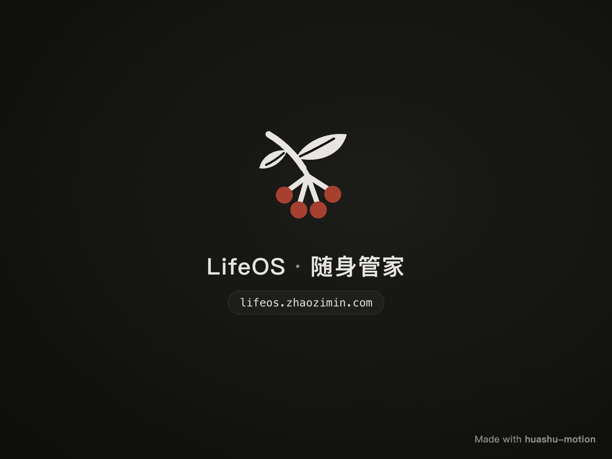

<!--
[INPUT]: 作者提供的LifeOS V3宣传成片与合成预览画面。
[OUTPUT]: 完整宣传片、动图预览和封面的公开导航。
[POS]: README宣传素材入口；不包含制作工程或私人运行数据。
[PROTOCOL]: 变更时更新此头部，然后检查 CLAUDE.md
-->
# LifeOS · 一天，连成一片

[完整宣传片 MP4](lifeos-launch.mp4) · [下载视频](https://github.com/zhaozimin/lifeos.zhaozimin.com/raw/refs/heads/main/docs/media/lifeos-launch.mp4) · [动图预览](lifeos-preview.gif) · [封面 PNG](lifeos-poster.png)

| 文件 | 规格 | 用途 |
|---|---|---|
| lifeos-launch.mp4 | 60秒，1440×1080，30fps，H.264/AAC，约18.2MiB | 完整宣传片，含配乐、无口播 |
| lifeos-preview.gif | 8秒，800×600，无声 | README动图，取成片开场与结尾 |
| lifeos-poster.png | 1440×1080 | 宣传封面，取成片结尾 |

画面中的时间、财务、健康和订阅均为合成演示数据。
订阅账号使用example.com；不包含本人账本或设备凭据。
完整视频保留作者提供的V3最终成片，不重新编码。
动图与封面从同一成片提取。

制片工具：[huashu-motion](https://github.com/alchaincyf/huashu-motion)。
产品与作者：[LifeOS](https://lifeos.zhaozimin.com) · [赵子民](https://zhaozimin.com)。

## English

The full launch film is included as MP4, with an animated README preview and a PNG poster.
All on-screen records are synthetic demo data. The original final film is preserved without re-encoding; the preview and poster are derived from it.
